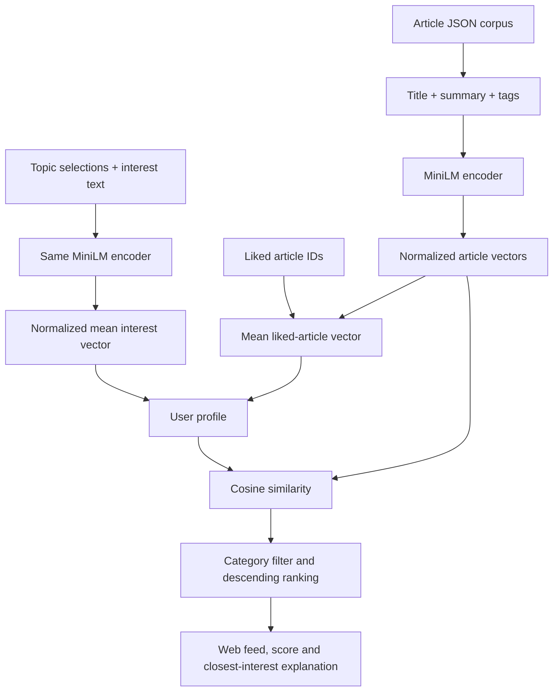

# Project 41: Personalized News Recommendation Using Semantic Embeddings

## Abstract

This project builds a content-based recommendation system that connects a reader's interests with related news text. A pretrained sentence encoder represents interests and article content in a shared vector space. The application forms a user profile, ranks articles with cosine similarity, and presents the results through a responsive web interface. A keyword baseline makes the difference between word overlap and semantic representation visible. The bundled corpus is an explicitly labeled collection of 24 fictional educational stories.

## Background and problem statement

The supplied project brief identifies a limitation of keyword-based recommendations: literal words may not capture the actual interests of users. Different words can express related ideas. For example, “storing sunshine after dark” can relate to battery storage and solar generation even if the wording differs substantially.

A keyword system also has limited ability to distinguish context. This project investigates a semantic representation of text as an alternative basis for content similarity. Embeddings are approximate learned representations and can still produce irrelevant matches.

## Objectives

1. Accept selected topics and free-text descriptions of user interests.
2. Generate semantic vectors for interests and article content.
3. Rank articles by similarity to the user profile.
4. Incorporate explicit likes into the profile.
5. Provide readable match explanations, bookmarks, and category filtering.
6. Compare semantic results with a reproducible keyword baseline.

## Main techniques

**Embeddings:** A quantized ONNX version of `all-MiniLM-L6-v2` produces a 384-dimensional sentence representation. Mean pooling aggregates token representations, followed by L2 normalization.

**Semantic similarity:** Cosine similarity compares the direction of the user vector with each article vector. For normalized vectors, the dot product equals cosine similarity.

**Recommendation system:** A content-based recommender sorts candidate articles by their similarity scores. It does not require other users' histories or collaborative filtering data.

## Architecture



The Node.js HTTP server serves the static frontend and three JSON API endpoints. Transformers.js performs inference locally on the CPU. Browser local storage persists topics, likes, and bookmarks. In-memory server caches avoid repeated article encoding and repeated encoding of recent interest sets.

## Mathematical formulation

Let `E(text)` denote the encoder output after mean pooling and normalization.

```text
Article vector a_i = E(title_i + summary_i + tags_i)
Interest vector q_j = E(interest_j)
Interest profile p = normalize(mean(q_1, ..., q_m))
Liked profile l = normalize(mean(a_k for liked article k))

If interests and likes exist: u = normalize(0.8 p + 0.2 l)
If only interests exist:     u = p
If only likes exist:         u = l
If neither exists:           request an interest or a like

score(u, a_i) = (u · a_i) / (||u|| ||a_i||)
```

The 80/20 weighting is an explicit design choice for this prototype, not a learned or experimentally optimized parameter. Each selected topic and the free-text field count as one interest vector, so selecting many topics reduces the relative influence of a single free-text description.

For the explanation, the system chooses the individual interest whose vector has the highest cosine similarity to the article. This identifies a model-based connection; it is not a causal explanation of all model behavior.

## Keyword baseline

The baseline lowercases and tokenizes text, removes a small explicit set of common words, and calculates:

```text
keyword_score = matching unique query terms / total unique query terms
```

Article terms come from title, summary, and tags. It does not perform stemming, synonym expansion, or BM25 weighting. This intentionally simple baseline is educational and should not be presented as representing every lexical retrieval method. Ties are resolved by article ID. When only likes are supplied, the keyword query is empty and all baseline scores are zero.

## Evaluation design

- Deterministic unit tests establish vector arithmetic, ranking order, profile blending, filtering, and validation behavior with controlled vectors.
- HTTP integration tests verify the API contract and model-loading response.
- `npm run evaluate` uses the actual model and eight fixed, manually labeled paraphrase queries.
- **Hit@3** counts queries with at least one expected relevant article in the first three positions.
- **MRR** averages the reciprocal rank of the first expected relevant article.
- The same queries are evaluated against the keyword baseline for comparison.

The dataset and queries are small and authored for this demonstration. Their scores are sanity checks, not generalization estimates. A stronger study would use a larger licensed news corpus, independently labeled queries, a held-out evaluation set, graded relevance, nDCG@k, latency measurements, and user feedback. No real-world accuracy claim is made.

## Demonstration sequence

1. Start the app and wait for **Semantic engine ready**.
2. Leave topic chips unselected and enter **storing sunshine to power homes after dark**.
3. Build the feed. Inspect the solar-storage story and its cosine score.
4. Open **Compare methods** and explain that semantic and keyword scores use different scales.
5. Change the interest to **discovering worlds orbiting distant stars** and refresh.
6. Demonstrate category filters, the reading dialog, bookmarks, and the Saved tab.
7. Like a story and explain the 80/20 profile blend.
8. Open **Behind your feed** to explain the pipeline.
9. Run `npm test` and `npm run evaluate` from the project folder.

## Limitations and future extensions

- The bundled articles are fictional examples, not live journalism. A live-feed importer needs publisher attribution, deduplication, licensing consideration, and robust parsing.
- The current encoder is primarily suitable for English; multilingual behavior is not established by these tests.
- Short summaries are embedded rather than full articles. Information absent from a summary cannot inform similarity.
- Similarity alone does not establish factual quality, freshness, trustworthiness, or user satisfaction.
- A single averaged profile can dilute diverse interests. A future system could score separate interest clusters or add a diversity objective.
- Likes can narrow a feed over time. The Explore view remains available, but this prototype does not optimize diversity or fairness.
- Profiles are local to one browser. Authentication, a persistent user database, telemetry controls, concurrency limits, and production deployment are outside this version.
- Large corpora would benefit from a persistent vector index and incremental updates; exhaustive comparison is appropriate for this small collection.

## References

1. Reimers and Gurevych, *Sentence-BERT: Sentence Embeddings using Siamese BERT-Networks*, 2019. https://arxiv.org/abs/1908.10084
2. MiniLM sentence-transformer model card. https://huggingface.co/sentence-transformers/all-MiniLM-L6-v2
3. Transformers.js-compatible ONNX model. https://huggingface.co/Xenova/all-MiniLM-L6-v2
4. Sentence Transformers semantic similarity documentation. https://www.sbert.net/docs/sentence_transformer/usage/semantic_textual_similarity.html
